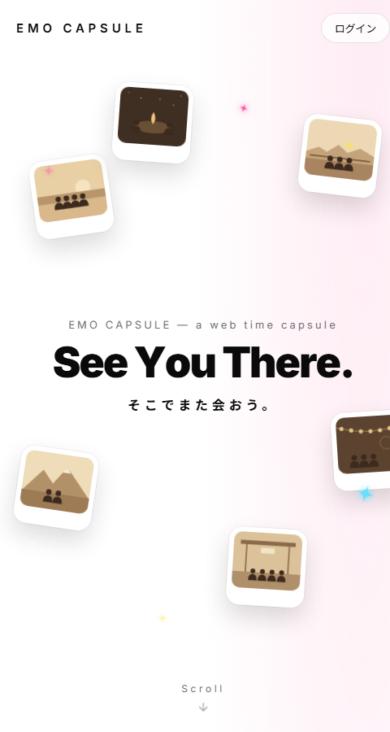
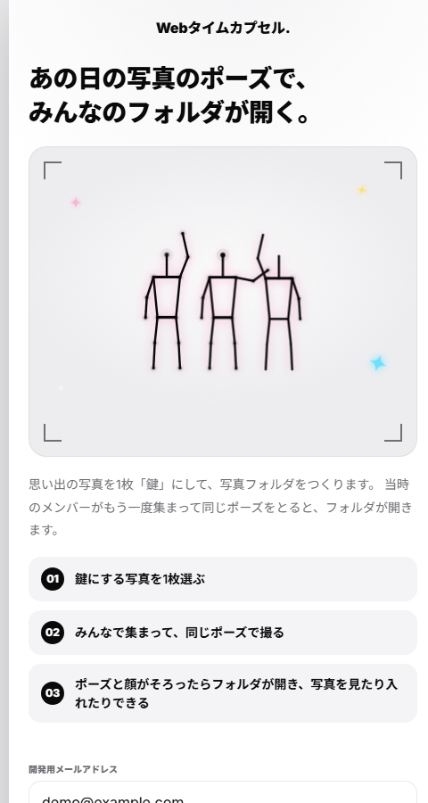
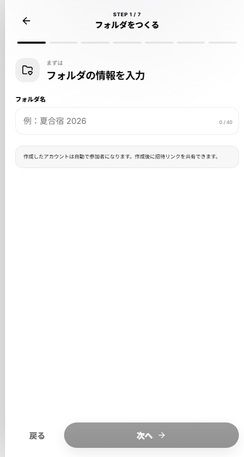
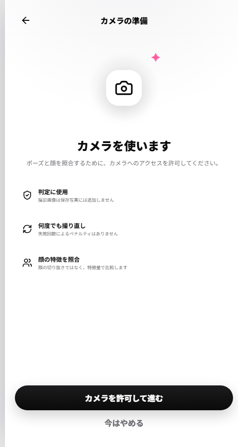
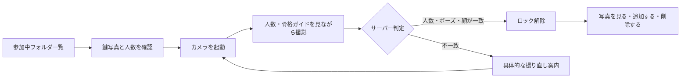
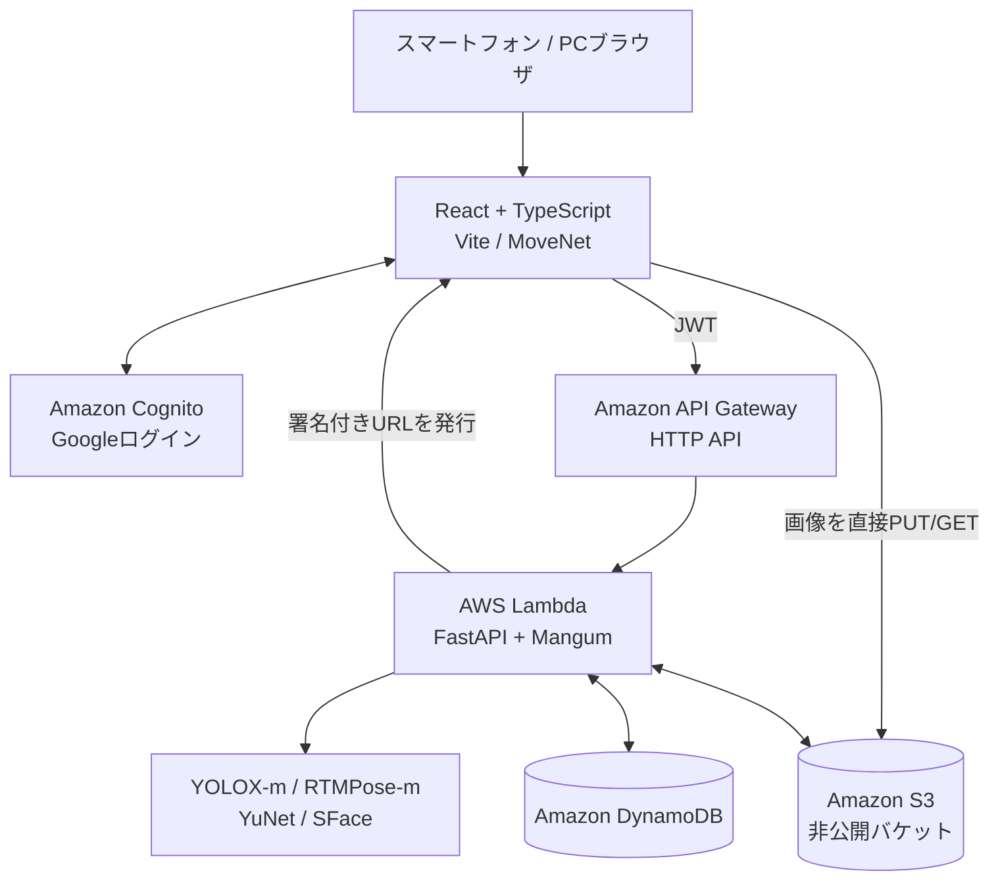

# エモカプセル

> あの日の写真のポーズで、みんなのフォルダが開く。

思い出の集合写真を「鍵」にする、スマートフォン向け共有写真フォルダです。当時のメンバーがもう一度集まり、同じ並び・同じポーズを再現するとロックが解除されます。

<p align="center">
  
</p>

## 目次

- [製品概要](#製品概要)
- [画面と利用フロー](#画面と利用フロー)
- [主な機能](#主な機能)
- [独自技術・注力した点](#独自技術注力した点)
- [認証の仕組み](#認証の仕組み)
- [システム構成](#システム構成)
- [開発技術](#開発技術)
- [ローカルで動かす](#ローカルで動かす)
- [テスト](#テスト)
- [現在の仕様と制約](#現在の仕様と制約)
- [関連ドキュメント](#関連ドキュメント)

## 製品概要

### 背景

卒業、就職、引っ越しなどで、昔の仲間と集まる機会は少しずつ減っていきます。写真はそれぞれのスマートフォンに残っていても、日常的に見返すことは少なく、「また集まろう」と声をかけるきっかけも簡単には生まれません。

エモカプセルは、思い出の写真そのものを「もう一度集まる理由」に変えます。単に写真を保存するのではなく、写真に残ったポーズをみんなで再現する体験までを思い出にします。

### 解決すること

- 「この写真を再現しよう」という具体的な再会のきっかけを作る
- メンバーの端末に散らばった写真を、1つの共有フォルダへ集める
- みんながそろったときだけ見られる、特別な写真体験を作る

### 3つの特徴

1. **思い出の写真が、そのまま鍵になる** — パスワードの代わりに、写真に写った人数・立ち位置・ポーズ・顔を利用します。

2. **当時のメンバーが集まると開く** — ポーズだけでなく顔も照合し、登録した写真のメンバーが同じ並びでそろったときに開きます。

3. **失敗理由が次の動きにつながる** — 「左の人の左ひじをもう少し下に」のように、直す位置と方向を返します。撮影は何度でもやり直せます。

課題背景の参考資料：[内閣府 孤独・孤立の実態把握に関する全国調査（令和7年）](https://www.cao.go.jp/kodoku_koritsu/torikumi/zenkokuchousa/r7/pdf/tyosakekka_point.pdf)

## 画面と利用フロー

### 実際の画面

<table>
  <tr>
    <td align="center"></td>
    <td align="center"></td>
    <td align="center"></td>
  </tr>
  <tr>
    <td align="center"><strong>ログイン</strong><br>Googleまたは開発用アカウントで開始</td>
    <td align="center"><strong>フォルダ作成</strong><br>7ステップで必要情報を登録</td>
    <td align="center"><strong>写真認証</strong><br>用途と保存方針を確認して撮影</td>
  </tr>
</table>

### フォルダを作る

作成者は次の項目を7ステップで設定します。

1. フォルダ名を入力
2. 任意の表紙画像を選択
3. 鍵にする集合写真を1枚選択
4. 鍵写真から抽出した人数・ポーズを確認
5. 最初から入れておく写真を選択（0〜20枚）
6. 入力内容を確認してフォルダを作成
7. 参加者用の招待リンクを発行

作成者自身は自動的に参加者になります。表紙を設定しなかった場合は、鍵写真を流用せず通常のフォルダ表紙を表示します。

### フォルダを開く



ロック解除後のトークンはタブの `sessionStorage` に保存します。画面を更新してもすぐには再ロックされず、最大12時間またはタブを閉じるまで閲覧できます。

## 主な機能

| 機能 | 内容 |
| --- | --- |
| アカウント | Cognito設定時はGoogleログイン、ローカルでは開発用アカウント |
| フォルダ一覧 | 自分が作成または参加したフォルダだけを表示 |
| フォルダ作成 | 名前、表紙、鍵写真、初期写真をまとめて登録 |
| メンバー招待 | 作成者が招待リンクを発行し、参加者が自分のアカウントで参加 |
| 撮影ガイド | MoveNet MultiPose Lightningで最大4人の人数と骨格をリアルタイム表示 |
| 最終認証 | RTMPoseによるポーズ判定と、YuNet・SFaceによる顔照合 |
| 写真管理 | 写真の一覧表示、追加、個別表示、削除 |
| 権限 | 参加後は全員が写真追加・写真削除・フォルダ削除可能 |
| プライバシー | 認証用に撮った写真は判定後に削除し、認証アルバムは作らない |

## 独自技術・注力した点

- **自由なポーズを比較できる正規化**：関節角度だけに頼らず、両肩の中心と肩幅を基準に手足の位置を比較します。撮影距離や画像サイズの差を吸収しながら、腕を曲げる・片手を隠すといったポーズも扱えます。
- **複数人が近くに並んでも混ざりにくい骨格推定**：YOLOX-mで人物領域を検出してからRTMPose-mを一人ずつ適用し、最大4人を左から順に対応付けます。
- **立ち位置を含めた顔照合**：本人との類似度だけでなく、別の立ち位置に登録された人との類似度も比較し、入れ替わりを検出します。
- **次の撮影につながるフィードバック**：単なるエラー表示ではなく、最もずれた人・部位・直す方向を自然な日本語で返します。
- **サーバー側での最終判定**：ブラウザの推定結果を信用せず、送信された画像をサーバーで解析し直します。撮影ガイドの軽快さと、判定の一貫性を分離しました。

## 認証の仕組み

### 1. 人数と並び順

鍵写真と認証写真で検出された人数を比較します。人物は腰の中央、腰が見えない場合は肩の中央を基準に左から並べ、同じ位置の人同士を照合します。

### 2. ポーズ

一人ずつ、両肩の中央を原点、肩幅を `1` として、左右のひじ・手首・ひざ・足首の位置を比較します。この正規化により、カメラとの距離や画像サイズが違っても比較できます。

既定の判定条件は次のとおりです。

- 各人の点の平均ずれ：肩幅の `0.35` 以内
- 1点の最大ずれ：肩幅の `1.0` 未満
- 鍵写真では見えていたが認証写真で隠れた点：1人2点まで
- 鍵写真で最初から見えていない点：比較対象外
- 両肩が見えない場合：撮り直し

関節角度も計算しますが、既定では合否ではなくフィードバック表示の補助に使います。

### 3. 顔

YuNetで顔を検出し、SFaceで128次元の特徴量へ変換します。立ち位置ごとに保存された特徴量と比較し、本人らしさと他の参加者との差を確認します。

保存するのは顔画像ではなく特徴量です。解除に成功したときの特徴量を少数だけ追加し、年月による見た目の変化に追従します。

### 4. ブラウザ内ガイドとサーバー判定の分離

- **ブラウザ：MoveNet** — 撮影中の人数・骨格を素早く表示するための補助
- **サーバー：YOLOX-m + RTMPose-m** — 送信された画像を読み直して行う最終判定

ブラウザから骨格座標だけを送って合否を決めることはありません。ガイドの読み込みに失敗しても撮影でき、最終結果はサーバー側の判定を使います。

## システム構成



画像はAPI Gatewayを経由させず、期限付きの署名付きURLを使ってブラウザとS3の間で直接送受信します。S3バケットは非公開です。

## 開発技術

### フロントエンド

- React 19
- TypeScript
- Vite
- React Router
- TensorFlow.js
- MoveNet MultiPose Lightning
- lucide-react
- Vitest / Testing Library / ESLint

### バックエンド・画像認識

- Python / FastAPI / Pydantic / Mangum
- YOLOX-m + RTMPose-m（人物検出・姿勢推定）
- OpenCV YuNet + SFace（顔検出・顔特徴量）
- ONNX Runtime / NumPy / Pillow
- pytest

### AWS

- Amazon Cognito
- Amazon API Gateway
- AWS Lambda（コンテナイメージ）
- Amazon ECR
- Amazon DynamoDB
- Amazon S3
- AWS Amplify Hosting

## ローカルで動かす

### 必要環境

- Node.js 20以上
- pnpm 11以上
- Python 3
- 姿勢・顔モデル用に約160MBの空き容量

### 1. リポジトリを取得

```bash
git clone https://github.com/jphacks/kz_2612.git
cd kz_2612
```

### 2. バックエンドを準備

Windows PowerShellまたはGit Bashで、次を実行します。

```bash
cd backend
python -m venv .venv
.venv/Scripts/python -m pip install -r requirements-dev.txt
.venv/Scripts/python -m pip install --no-deps -r requirements-nodeps.txt
.venv/Scripts/python scripts/download_models.py
.venv/Scripts/python -m app.dev
```

起動後、次のURLを利用できます。

- API：<http://localhost:8000>
- Swagger UI：<http://localhost:8000/docs>
- バックエンド簡易テスト画面：<http://localhost:8000/dev>

詳細は [backend/README.md](backend/README.md) を参照してください。

### 3. フロントエンドを準備

別のターミナルでリポジトリのルートへ戻り、環境変数を用意します。

```bash
cp .env.example .env.local
pnpm install
pnpm dev
```

Windows PowerShellでコピーする場合：

```powershell
Copy-Item .env.example .env.local
```

ブラウザで <http://localhost:5173> を開きます。

`.env.local` の最小設定：

```dotenv
VITE_API_BASE_URL=http://localhost:8000
VITE_DEMO_USER_ID=demo-user
VITE_DEMO_USER_EMAIL=demo@example.com
```

Cognitoを設定すると、開発用メール入力の代わりにGoogleログインを使用します。

```dotenv
VITE_COGNITO_DOMAIN=https://<your-domain>.auth.ap-northeast-1.amazoncognito.com
VITE_COGNITO_CLIENT_ID=<app-client-id>
VITE_COGNITO_REDIRECT_URI=http://localhost:5173/auth/callback
```

本番環境の具体的な設定手順は [infra/README.md](infra/README.md) を参照してください。秘密情報や個人用の `.env.local` はコミットしないでください。

## テスト

### フロントエンド

```bash
pnpm test
pnpm lint
pnpm build
```

### バックエンド

```bash
cd backend
.venv/Scripts/python -m pytest
```

2枚の写真を直接比較するCLIも利用できます。

```bash
cd backend
.venv/Scripts/python -m app.pose.cli path/to/key.jpg path/to/attempt.jpg --overlay-dir out/
```

## 現在の仕様と制約

| 項目 | MVP仕様 |
| --- | --- |
| 対象端末 | スマートフォン向けWebアプリ（PCブラウザでも利用可能） |
| 鍵写真 | 1フォルダにつき1枚。作成後は変更不可 |
| 表紙画像 | 任意。作成後は変更不可 |
| 参加者 | 作成者を含めて最大4アカウント |
| 招待 | 作成直後に作成者がリンクを発行。参加後の追加・削除はMVP対象外 |
| 権限 | 写真追加・写真削除・フォルダ削除は全参加者が同権限 |
| 保存内容 | 写真のみ。メッセージ投稿は対象外 |
| 写真上限 | 1フォルダ最大20枚 |
| 認証試行 | 回数制限なし |
| ロック解除 | 最大12時間。画面更新だけでは再ロックしない |
| 認証画像 | 判定直後に削除。認証アルバムは作成しない |
| カメラ | 縦・横画面に対応し、全画角を切り抜かず表示 |
| 撮影ガイド | 最大4人。ガイドが利用できなくても撮影・サーバー判定は可能 |

## ディレクトリ構成

```text
.
├─ src/                 Reactフロントエンド
│  ├─ api/              APIクライアントと型
│  ├─ components/       共通UI・骨格オーバーレイ
│  ├─ hooks/            MoveNet撮影ガイド
│  ├─ lib/              認証・画像処理・セッション管理
│  └─ pages/            各画面
├─ backend/             FastAPI・姿勢推定・顔照合
│  ├─ app/pose/         RTMPose・照合ロジック
│  ├─ app/routers/      APIエンドポイント
│  └─ tests/            バックエンドテスト
├─ docs/                API仕様・README用画像
└─ infra/               AWS設定・デプロイスクリプト
```

## 関連ドキュメント

- [API仕様](docs/api.md)
- [バックエンド・画像認識](backend/README.md)
- [AWSインフラ・デプロイ](infra/README.md)
- [ライセンス](LICENSE)

## 今後の展望

- 集まる予定を共有する通知機能
- 離れた場所からそれぞれ撮影し、複数の写真を組み合わせて開ける仕組み
- 実機データを使ったポーズ・顔判定しきい値の継続調整
- ガイドモデルのアプリ内配信による初回起動時間の短縮
